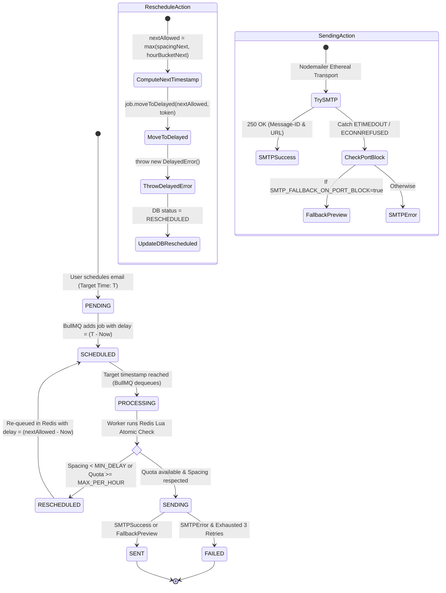

# ReachInbox Full-Stack Email Job Scheduler
## Master Architecture & System Design Document (Stage M)

---

## 1. Executive Summary & Core Mission

The **ReachInbox Email Job Scheduler** is a high-reliability, distributed background processing engine and dashboard designed to dispatch scheduled email batches at scale while adhering to strict sender rate limits, inter-email delay spacing, and zero-loss persistence guarantees.

Traditional solutions rely on polling mechanisms like `node-cron` or interval loops that suffer from clock drift, worker race conditions, duplicate sends, and catastrophic memory bloat. This system implements an enterprise-grade, **Zero-Cron Architecture** powered by **BullMQ Delayed Jobs** backed by **Redis** and **PostgreSQL** (Prisma ORM).

---

## 2. Non-Negotiable Hard Constraints & Design Philosophy

### 2.1 Zero Cron Jobs Constraint
* **No `node-cron`, `cron`, `agenda`, or OS `crontab`**: All scheduling, execution throttling, backoff, and rate-limit rescheduling operate strictly via **BullMQ delayed jobs** using millisecond timestamps (`delay` option and `job.moveToDelayed(timestamp, token)`).
* **Mathematical Precision**: Instead of polling a database every minute to find pending emails (which introduces $O(N)$ database scans and concurrency collisions), jobs are scheduled directly to Redis sorted sets (`zset`) with execution scores equal to their target UNIX timestamp in milliseconds. Redis wakes the worker precisely when the delay expires ($O(\log N)$ extraction).

### 2.2 Persistence & Crash-Survival Guarantees
* **PostgreSQL as Single Source of Truth**: Every email, batch, recipient, and send attempt is modeled in PostgreSQL. Status transitions follow strict state invariants (`PENDING`, `SCHEDULED`, `PROCESSING`, `RESCHEDULED`, `SENT`, `FAILED`).
* **Redis as Persistent Execution Buffer**: If the Node.js process crashes, terminates, or restarts during mid-execution:
  1. Active unacknowledged jobs are automatically recovered via BullMQ's stalled job lock mechanism (`lockDuration: 30000ms`).
  2. Completed jobs are never re-dispatched due to atomic status checks against PostgreSQL before SMTP invocation.
  3. Delayed jobs remain in the Redis sorted set and fire immediately when their scheduled time arrives upon worker reboot.

### 2.3 Distributed Rate Limiting & Spacing (Atomic Redis Lua)
* **Configurable Global Defaults & Batch Overrides**:
  - `WORKER_CONCURRENCY=5`
  - `MIN_DELAY_BETWEEN_EMAILS_MS=2000` (Minimum interval between any two emails from the same sender)
  - `MAX_EMAILS_PER_HOUR_PER_SENDER=200` (Max emails dispatched per sender within a sliding/hourly window)
* **Atomic Redis State**: Evaluated atomically via Lua scripts to avoid race conditions across multi-worker clusters:
  - Hourly quota key: `rate_limit:{senderId}:{YYYY-MM-DD-HH}` (TTL: 7200 seconds)
  - Spacing tracker: `last_sent_at:{senderId}` (UNIX millisecond timestamp)
* **Dynamic BullMQ `moveToDelayed` Rescheduling**:
  - If a worker picks up a job and determines that either the hourly quota is exhausted or the minimum spacing window has not elapsed, the worker **MUST NOT fail or discard the job**.
  - Instead, the worker calculates the exact earliest valid millisecond timestamp `nextAllowedTimestamp`, invokes:
    ```typescript
    await job.moveToDelayed(nextAllowedTimestamp, token);
    throw new DelayedError();
    ```
  - The PostgreSQL status is transitioned to `RESCHEDULED` with `scheduledFor = nextAllowedTimestamp` and an incremented `rescheduleCount`.

### 2.4 Free-Tier Cloud Optimizations
* **Dual-Mode Worker Architecture (`RUN_WORKER_IN_API=true`)**:
  - Locally and in standard cloud environments, the Express API (`src/server.ts`) and BullMQ Worker (`src/workers/email.worker.ts`) run as distinct decoupled OS processes.
  - On restricted single-container free-tier platforms (e.g., Render Free Web Service, Koyeb), setting `RUN_WORKER_IN_API=true` allows `src/server.ts` to boot the worker threads in-process without consuming a secondary paid dyno.
* **Redis 30MB Free-Tier Hygiene (Upstash / Aiven)**:
  - BullMQ default job retention is tuned aggressively to prevent memory starvation:
    ```typescript
    defaultJobOptions: {
      removeOnComplete: { count: 100, age: 3600 }, // Keep last 100 completed for 1 hr
      removeOnFail: { count: 200, age: 86400 },     // Keep last 200 failed for 24 hrs
      attempts: 3,
      backoff: { type: 'exponential', delay: 5000 }
    }
    ```
  - Connection reuse: Singleton pattern sharing exactly 2 `ioredis` instances (`maxRetriesPerRequest: null`, `enableReadyCheck: false`).
* **Smart Ethereal SMTP Transport & Port Fallback**:
  - Outbound emails utilize Nodemailer with Ethereal Email (`nodemailer.createTestAccount()`), automatically generating inspectable preview URLs (`nodemailer.getTestMessageUrl(info)`).
  - Certain free cloud hosts block outbound port 587 (`ETIMEDOUT` / `ECONNREFUSED`). Setting `SMTP_FALLBACK_ON_PORT_BLOCK=true` ensures the worker catches network-level port blocking, formats a deterministic preview, persists the rendered HTML/preview URL, and marks the job as `SENT` with fallback metadata so evaluations never fail.

---

## 3. High-Level Architecture Diagram

```mermaid
flowchart TB
    subgraph Client["Frontend (React 18 + Vite + Tailwind)"]
        UI[ReachInbox UI / Dashboard]
        AuthUI[Google OAuth 2.0 / JWT]
        Composer[Campaign Composer & CSV Uploader]
        Analytics[Real-Time Job Analytics & Logs]
    end

    subgraph API_Layer["Backend API Server (Express + TypeScript)"]
        Router[REST API Endpoints /api/v1]
        AuthGuard[JWT / Google Auth Middleware]
        ZodValidator[Zod Input Validation]
        JobService[Email Scheduling Service]
    end

    subgraph Persistence["Storage & Queue Layer"]
        PG[(PostgreSQL Database\nPrisma ORM)]
        subgraph RedisInstance["Redis (Persistent Queue & Distributed Locks)"]
            BullQueue[BullMQ 'email-queue']
            RateLimiterKeys["Rate Limit Keys (Lua Atomic)\nrate_limit:{senderId}:{bucket}\nlast_sent_at:{senderId}"]
        end
    end

    subgraph Processing["Execution Engine (Dual-Mode Worker)"]
        Worker[BullMQ Email Worker]
        LuaEngine[Redis Lua Quota & Spacing Checker]
        SMTPClient[Nodemailer Ethereal Transport]
        FallbackEngine[Smart Port Block Fallback Simulator]
    end

    UI -->|HTTPS / JWT| Router
    Router --> AuthGuard --> ZodValidator --> JobService
    JobService -->|1. Write Job Status: PENDING| PG
    JobService -->|2. Push Delayed Job (delay: ms)| BullQueue

    BullQueue -->|Pulls Ready Job| Worker
    Worker -->|Check & Claim Quota| LuaEngine
    LuaEngine --> RateLimiterKeys

    Worker -->|If Quota/Spacing Exceeded| Worker
    Worker -.->|job.moveToDelayed(nextTs) + DelayedError| BullQueue
    Worker -.->|Update Status: RESCHEDULED| PG

    Worker -->|If Allowed: Send Email| SMTPClient
    SMTPClient -->|Port 587 Blocked?| FallbackEngine
    SMTPClient -->|Success URL| PG
    FallbackEngine -->|Fallback Preview URL| PG
    Worker -->|Update Status: SENT / FAILED| PG
    Analytics -->|Polls Status & Metrics| Router
```

---

## 4. BullMQ Rescheduling State Machine

Every email job moves through a deterministic state machine. No job is ever lost or silently discarded.



---

## 5. Distributed Rate Limiting & Spacing Algorithm (Redis Lua)

To prevent race conditions when multiple worker instances attempt to dispatch emails for the same sender identity simultaneously, rate limits and delay spacings are evaluated inside an **atomic Redis Lua script**.

### 5.1 Keys and Arguments
* **KEYS[1]**: `last_sent_at:{senderId}` (Holds the UNIX timestamp in ms of the last dispatched email)
* **KEYS[2]**: `rate_limit:{senderId}:{YYYY-MM-DD-HH}` (Holds the count of emails sent within the current UTC hour)
* **ARGV[1]**: Current timestamp in milliseconds (`nowMs`)
* **ARGV[2]**: Required minimum spacing in milliseconds (`minDelayMs`)
* **ARGV[3]**: Maximum allowed emails per hour (`maxPerHour`)
* **ARGV[4]**: Key expiry in seconds (e.g., 7200 for the hourly bucket)

### 5.2 Lua Script Implementation Logic
```lua
-- check_and_record_rate_limit.lua
local lastSentKey = KEYS[1]
local hourlyKey = KEYS[2]

local nowMs = tonumber(ARGV[1])
local minDelayMs = tonumber(ARGV[2])
local maxPerHour = tonumber(ARGV[3])
local ttlSec = tonumber(ARGV[4])

-- 1. Check Minimum Spacing Violation
local lastSent = redis.call('GET', lastSentKey)
if lastSent then
    local diff = nowMs - tonumber(lastSent)
    if diff < minDelayMs then
        local retryAfterMs = minDelayMs - diff
        return { 0, "SPACING_LIMIT", retryAfterMs }
    end
end

-- 2. Check Hourly Quota
local currentCount = tonumber(redis.call('GET', hourlyKey) or "0")
if currentCount >= maxPerHour then
    -- Return wait time until next hour bucket starts
    local msInHour = 3600000
    local msIntoCurrentHour = nowMs % msInHour
    local waitMs = msInHour - msIntoCurrentHour + 1000 -- buffer 1s
    return { 0, "HOURLY_QUOTA_EXCEEDED", waitMs }
end

-- 3. Atomic Reservation
redis.call('SET', lastSentKey, tostring(nowMs))
redis.call('INCR', hourlyKey)
if currentCount == 0 then
    redis.call('EXPIRE', hourlyKey, ttlSec)
end

return { 1, "ALLOWED", 0 }
```

### 5.3 Return Values and Worker Action
1. **`{1, "ALLOWED", 0}`**: Worker proceeds with SMTP dispatch immediately.
2. **`{0, "SPACING_LIMIT", retryAfterMs}`**: Worker calculates `nextAllowed = nowMs + retryAfterMs`, calls `job.moveToDelayed(nextAllowed, token)` and throws `new DelayedError()`.
3. **`{0, "HOURLY_QUOTA_EXCEEDED", waitMs}`**: Worker calculates `nextAllowed = nowMs + waitMs`, calls `job.moveToDelayed(nextAllowed, token)` and throws `new DelayedError()`.

---

## 6. PostgreSQL Database Schema Specification

The database utilizes Prisma ORM with strict indexing for rapid querying of email states and analytics.

```prisma
datasource db {
  provider = "postgresql"
  url      = env("DATABASE_URL")
}

generator client {
  provider = "prisma-client-js"
}

enum EmailStatus {
  PENDING
  SCHEDULED
  PROCESSING
  RESCHEDULED
  SENT
  FAILED
}

model User {
  id            String         @id @default(uuid())
  email         String         @unique
  name          String?
  avatar        String?
  googleId      String?        @unique
  createdAt     DateTime       @default(now())
  updatedAt     DateTime       @updatedAt
  senders       SenderIdentity[]
  campaigns     Campaign[]
}

model SenderIdentity {
  id              String      @id @default(uuid())
  userId          String
  user            User        @relation(fields: [userId], references: [id], onDelete: Cascade)
  email           String
  displayName     String?
  hourlyQuota     Int         @default(200)
  minDelayMs      Int         @default(2000)
  createdAt       DateTime    @default(now())
  updatedAt       DateTime    @updatedAt
  emailJobs       EmailJob[]

  @@unique([userId, email])
}

model Campaign {
  id          String      @id @default(uuid())
  userId      String
  user        User        @relation(fields: [userId], references: [id], onDelete: Cascade)
  title       String
  createdAt   DateTime    @default(now())
  updatedAt   DateTime    @updatedAt
  jobs        EmailJob[]
}

model EmailJob {
  id              String         @id @default(uuid())
  campaignId      String?
  campaign        Campaign?      @relation(fields: [campaignId], references: [id], onDelete: SetNull)
  senderId        String
  sender          SenderIdentity @relation(fields: [senderId], references: [id], onDelete: Cascade)
  recipient       String
  subject         String
  bodyText        String
  bodyHtml        String?
  status          EmailStatus    @default(PENDING)
  scheduledFor    DateTime
  sentAt          DateTime?
  rescheduleCount Int            @default(0)
  errorMessage    String?
  previewUrl      String?        // Ethereal test preview URL or local fallback URI
  messageId       String?
  metadata        Json?          // Stores headers, fallback flags, etc.
  createdAt       DateTime       @default(now())
  updatedAt       DateTime       @updatedAt

  @@index([status, scheduledFor])
  @@index([senderId, status])
  @@index([campaignId])
}
```

---

## 7. Dual-Mode Worker & Deployment Topology

### 7.1 Single-Dyno vs. Multi-Dyno Mode
* **Local / Standard Production (`RUN_WORKER_IN_API=false`)**:
  - Process A: Express API server (`ts-node-dev src/server.ts`) handles incoming webhooks, Google OAuth, scheduling requests, and metrics API.
  - Process B: Dedicated BullMQ Worker (`ts-node-dev src/workers/email.worker.ts`) handles queue events, SMTP dispatch, and rate-limiting.
* **Free-Tier PaaS Mode (`RUN_WORKER_IN_API=true`)**:
  - `src/server.ts` checks `process.env.RUN_WORKER_IN_API === 'true'`.
  - If true, it imports `startEmailWorker()` and runs the worker in the same Node.js event loop, enabling complete operation within Render's free 512MB single service quota.

### 7.2 Cloud Infrastructure Mapping
| Component | Local Development | Free-Tier Cloud Deployment |
| :--- | :--- | :--- |
| **Backend API + Worker** | Docker / Node.js 18+ | Render / Koyeb (Single Web Service with `RUN_WORKER_IN_API=true`) |
| **Database** | Docker PostgreSQL 15 | Neon / Supabase (Free PostgreSQL) |
| **Queue / Cache** | Docker Redis 7 Alpine | Upstash Redis (Free 10,000 commands/day, 256MB) |
| **Email Transport** | Nodemailer Ethereal | Ethereal Email + Deterministic Local Port-Block Fallback |
| **Frontend Dashboard** | Vite Dev Server (Port 5173) | Vercel / Netlify / Render Static Site |

---

## 8. Directory Structure (Monorepo Layout)

```
reachinbox-scheduler/
├── ARCHITECTURE.md                  # System design, data lifecycle & algorithms
├── docker-compose.yml               # Local PostgreSQL 15 & Redis 7 Alpine
├── .gitignore                       # Standard ignore rules
├── backend/
│   ├── package.json                 # Node dependencies (BullMQ, Prisma, Express, etc.)
│   ├── tsconfig.json                # TypeScript compiler config
│   ├── .env.example                 # Environment variables specification
│   ├── prisma/
│   │   └── schema.prisma            # Prisma ORM schema
│   └── src/
│       ├── config/                  # Redis, Database & App environment config
│       ├── controllers/             # Express route controllers
│       ├── middlewares/             # Auth, error handling & validation middlewares
│       ├── queues/                  # BullMQ queue singletons & connection instances
│       ├── routes/                  # Express API route declarations
│       ├── scripts/                 # Lua rate-limiting scripts
│       ├── services/                # Business logic (email, scheduling, rate limiter)
│       ├── types/                   # TypeScript interfaces and type definitions
│       ├── utils/                   # Logger, time helpers, Ethereal helper
│       ├── workers/                 # BullMQ Worker implementation
│       └── server.ts                # Express server entry point
└── frontend/
    ├── package.json                 # React 18, Vite, Tailwind CSS, Lucide
    ├── tsconfig.json                # Frontend TypeScript config
    ├── tsconfig.node.json           # Vite Node TypeScript config
    ├── tailwind.config.js           # ReachInbox styling palette & dark theme
    ├── postcss.config.js            # PostCSS configuration
    ├── .env.example                 # Frontend API endpoints & OAuth client IDs
    ├── index.html                   # HTML entry point
    └── src/
        ├── assets/                  # Logos and static media
        ├── components/              # UI components (modal, table, badge, composer)
        ├── hooks/                   # Custom React hooks (useAuth, useJobs, useMetrics)
        ├── pages/                   # Views (Dashboard, CampaignList, JobDetail, Login)
        ├── services/                # Axios API client & Google OAuth service
        ├── types/                   # Frontend TypeScript interfaces
        ├── App.tsx                  # Root application component
        └── main.tsx                 # React DOM mount point
```

---

## 9. Next Steps (Stage Lock & Phase Roadmap)

1. **Stage M Complete**: Project structure, configuration templates, and architectural contracts established.
2. **Phase 1**: Database schema migration (`prisma migrate dev`), Redis singleton setup, and Lua script integration.
3. **Phase 2**: BullMQ Email Queue, Worker logic with `moveToDelayed` state machine, and Smart Ethereal Transport.
4. **Phase 3**: Express API endpoints (Auth, Scheduling, Batch CSV Ingestion, Metrics).
5. **Phase 4**: Modern React 18 Dashboard with real-time job timeline, dark mode, and metrics visualizer.
6. **Phase 5**: End-to-end testing, failure recovery verification, and deployment readiness checks.
