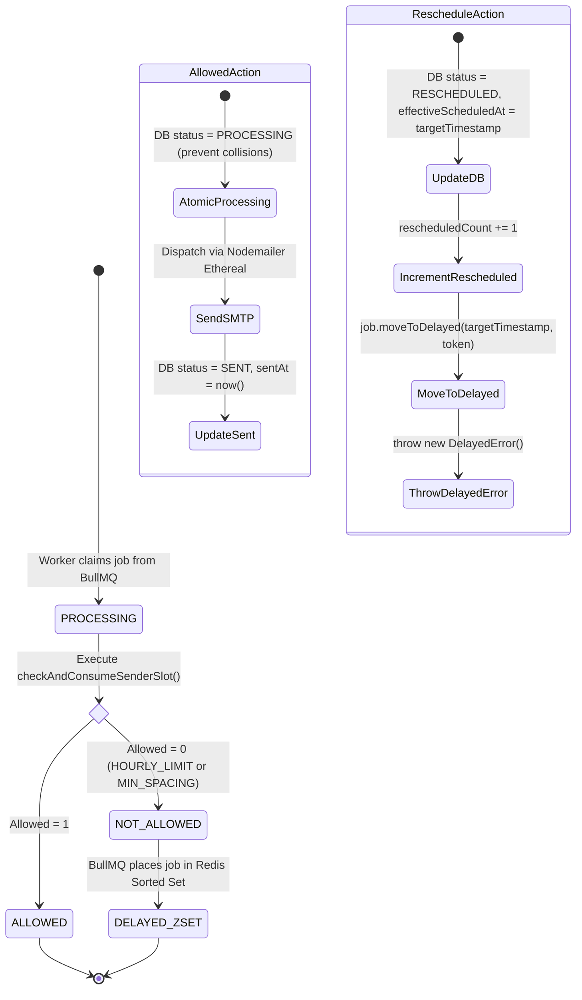

# Distributed Rate Limiting & Non-Destructive Rescheduling

## 1. Overview & Core Philosophy

In cold outreach engines, hitting a sender's rate limit must **never result in a failed job or dropped email**. Instead, the system must gracefully delay the job until the earliest valid sending slot.

Because multiple worker threads can process jobs for the same sender identity simultaneously across distributed nodes, evaluating rate limits using standard application-level code (e.g., `await redis.get()` followed by `await redis.set()`) creates a classic **Time-of-Check to Time-of-Use (TOCTOU) race condition**.

To achieve 100% atomic thread safety, ReachInbox evaluates and reserves rate-limit slots directly inside an **Atomic Redis Lua script**.

---

## 2. The Atomic Redis Lua Script

The script evaluates three distinct constraints in a single Redis transaction:
1. **Hourly Quota**: Has the sender reached `hourlyLimit` (e.g. 200 emails) in the current UTC hour window?
2. **Inter-Email Delay Spacing**: Has `delayBetweenEmailsMs` (e.g. 2000ms) elapsed since this sender's last dispatch?
3. **Next-Hour Overflow Staggering**: When rescheduled into the next hour, jobs must not all pile up at `XX:00:00.000`—they must stagger cleanly by `delayBetweenEmailsMs`.

### Script Signature & Parameters

| Parameter | Identifier | Description |
| :--- | :--- | :--- |
| **KEYS[1]** | `hourlyKey` | `rate_limit:{senderId}:{YYYY-MM-DD-HH}` (hourly counter, TTL 7200s) |
| **KEYS[2]** | `lastSentKey` | `last_sent_at:{senderId}` (UNIX timestamp in ms of last allowed send) |
| **KEYS[3]** | `overflowKey` | `next_hour_overflow_seq:{senderId}:{nextHourBucket}` (sequence counter for next hour) |
| **ARGV[1]** | `nowMs` | Current UNIX timestamp in milliseconds |
| **ARGV[2]** | `hourlyLimit` | Configured max emails per hour (default 200) |
| **ARGV[3]** | `minDelayMs` | Configured inter-email spacing (default 2000ms) |
| **ARGV[4]** | `nextHourStartMs` | Millisecond timestamp of the beginning of the next UTC clock hour |

### Lua Code Walkthrough

```lua
local hourlyKey = KEYS[1]
local lastSentKey = KEYS[2]
local overflowKey = KEYS[3]

local nowMs = tonumber(ARGV[1])
local hourlyLimit = tonumber(ARGV[2])
local minDelayMs = tonumber(ARGV[3])
local nextHourStartMs = tonumber(ARGV[4])

-- 1. Read current hourly count
local currentCount = tonumber(redis.call('GET', hourlyKey) or '0')

-- 2. If hourly limit reached: Stagger into next hour
if currentCount >= hourlyLimit then
    local overflowIndex = redis.call('INCR', overflowKey) - 1
    redis.call('EXPIRE', overflowKey, 7200)
    local targetTimestamp = nextHourStartMs + (overflowIndex * minDelayMs)
    return { 0, 'HOURLY_LIMIT_REACHED', tostring(targetTimestamp), currentCount }
end

-- 3. Read lastSentMs
local lastSentMs = tonumber(redis.call('GET', lastSentKey) or '0')

-- 4. Check minimum spacing violation
if lastSentMs > 0 and (nowMs - lastSentMs) < minDelayMs then
    local targetTimestamp = lastSentMs + minDelayMs
    if targetTimestamp >= nextHourStartMs and (currentCount + 1) > hourlyLimit then
        local overflowIndex = redis.call('INCR', overflowKey) - 1
        redis.call('EXPIRE', overflowKey, 7200)
        targetTimestamp = nextHourStartMs + (overflowIndex * minDelayMs)
        return { 0, 'HOURLY_LIMIT_REACHED', tostring(targetTimestamp), currentCount }
    end
    -- Atomically reserve the spaced slot for concurrent workers!
    redis.call('SET', lastSentKey, tostring(targetTimestamp), 'PX', 3600000)
    return { 0, 'MIN_SPACING_DELAY', tostring(targetTimestamp), currentCount }
end

-- 5. Allowed: Atomically increment quota & update spacing
local newCount = redis.call('INCR', hourlyKey)
if newCount == 1 then
    redis.call('EXPIRE', hourlyKey, 7200)
end
redis.call('SET', lastSentKey, tostring(nowMs), 'PX', 3600000)
return { 1, 'ALLOWED', tostring(nowMs), newCount }
```

---

## 3. Rescheduling State Machine

When the Lua script returns `allowed == 0`, the BullMQ worker triggers the non-destructive rescheduling workflow:



### Why `throw new DelayedError()` is Critical

In BullMQ, calling `await job.moveToDelayed(targetTimestamp, token)` moves the job in Redis, but standard processor functions expect to either `return` a value (which marks the job as `COMPLETED`) or `throw` an error (which marks the job as `FAILED` and increments failed attempts).

BullMQ provides a specialized exception:
```typescript
import { DelayedError } from 'bullmq';

await job.moveToDelayed(decision.nextAllowedTimestampMs, token);
throw new DelayedError();
```
When `DelayedError` is thrown, BullMQ catches it internally, suppresses the failure event, leaves failed attempts at `0`, and keeps the job in the `delayed` state until `targetTimestamp` arrives.
